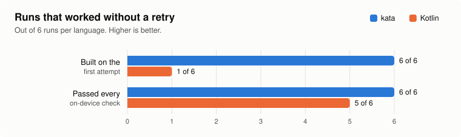
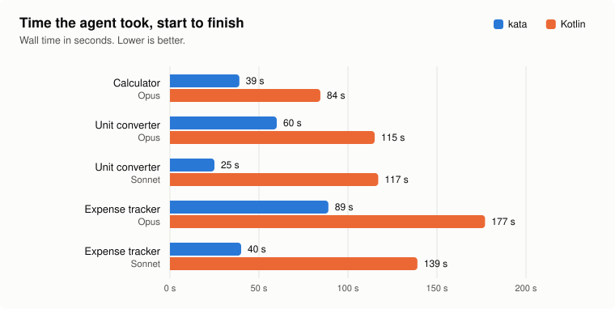
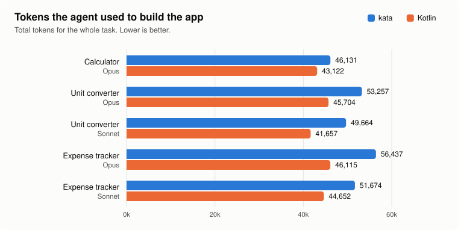
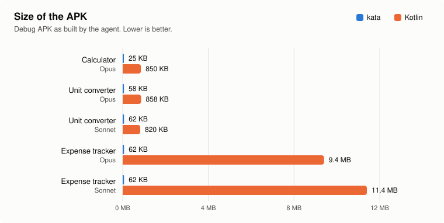
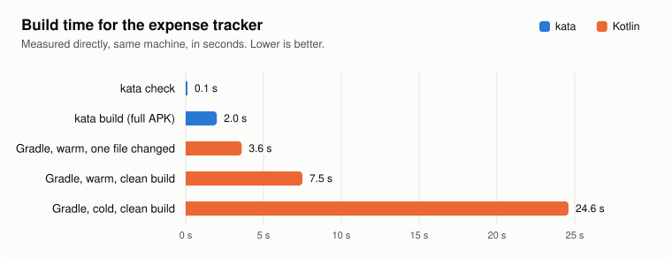

# Benchmarks: kata and Kotlin

What it costs an AI agent to build the same Android app from scratch in kata and in Kotlin.

## Method

- A fresh agent gets one task and no earlier context. For kata it gets [`docs/kata-guide.md`](../kata-guide.md) and the compiler. For Kotlin it gets an empty directory, the Android SDK and Gradle, and chooses its own libraries.
- Both get the same requirements text: [`converter/requirements.md`](converter/requirements.md), [`expense/requirements.md`](expense/requirements.md). The calculator's requirements were given in the prompt and are not kept here.
- The result is installed on an emulator and driven by one script per task, the same for both languages: [`calculator/verify.py`](calculator/verify.py), [`converter/verify_conv.py`](converter/verify_conv.py) (14 checks), [`expense/verify_exp.py`](expense/verify_exp.py) (22 checks). They use [`scripts/e2e.py`](../../scripts/e2e.py).
- Tokens and wall time are the agent's totals for the whole task, as reported by the harness.
- Each condition was run once, except Kotlin on the calculator, which was run twice. The figures average those two runs and leave out kata's first calculator run, which was given the full specification instead of the guide.

## Results

<picture>
  <source media="(prefers-color-scheme: dark)" srcset="img/reliability-dark.svg">
  
</picture>

<picture>
  <source media="(prefers-color-scheme: dark)" srcset="img/time-dark.svg">
  
</picture>

<picture>
  <source media="(prefers-color-scheme: dark)" srcset="img/tokens-dark.svg">
  
</picture>

<picture>
  <source media="(prefers-color-scheme: dark)" srcset="img/apk-dark.svg">
  
</picture>

<picture>
  <source media="(prefers-color-scheme: dark)" srcset="img/build-dark.svg">
  
</picture>

| Task | Model | Language | Tokens | Time | Builds (failed) | Source | APK | Checks |
|---|---|---|---|---|---|---|---|---|
| Calculator | Opus | kata, full spec | 62,054 | 54 s | 1 (0) | 158 lines, 4,542 chars | 25 KB | pass |
| Calculator | Opus | kata, guide | 46,131 | 39 s | 1 (0) | 141 lines, 3,476 chars | 25 KB | pass |
| Calculator | Opus | Kotlin (Views), run 1 | 43,349 | 88 s | 2 (1) | 137 lines, 4,660 chars | 845 KB | pass |
| Calculator | Opus | Kotlin (Views), run 2 | 42,896 | 81 s | 2 (1) | 127 lines, 4,622 chars | 855 KB | pass |
| Unit converter | Opus | kata | 53,257 | 60 s | 1 (0) | 182 lines, 4,541 chars | 58 KB | 14 / 14 |
| Unit converter | Opus | Kotlin (Views) | 45,704 | 115 s | 2 (1) | 172 lines, 6,098 chars | 858 KB | 7 / 14 |
| Unit converter | Sonnet | kata | 49,664 | 25 s | 1 (0) | 156 lines, 3,811 chars | 62 KB | 14 / 14 |
| Unit converter | Sonnet | Kotlin (Views) | 41,657 | 117 s | 1 (0) | 136 lines, 5,554 chars | 820 KB | 14 / 14 |
| Expense tracker | Opus | kata | 56,437 | 89 s | 1 (0) | 347 lines, 9,178 chars | 62 KB | 22 / 22 |
| Expense tracker | Opus | Kotlin (Compose) | 46,115 | 177 s | 2 (1) | 184 lines, 8,068 chars | 9.4 MB | 22 / 22 |
| Expense tracker | Sonnet | kata | 51,674 | 40 s | 1 (0) | 318 lines, 8,765 chars | 62 KB | 22 / 22 |
| Expense tracker | Sonnet | Kotlin (Compose) | 44,652 | 139 s | 2 (1) | 161 lines, 7,966 chars | 11.4 MB | 22 / 22 |

Build times were measured directly on the expense tracker, outside the agent runs: `kata check` 0.1 s, `kata build` about 2 s (1.9, 2.0, 2.5), Gradle 24.6 s cold, 7.5 s warm for a clean build, 3.6 s warm after changing one file.

## What the numbers do not show

- One run per condition. A second run could move any single number.
- kata changed between runs: `isFloat()` was added after the Opus converter run, and the Material look was added before the expense tracker, which is why the APK grew from 25 KB to about 60 KB.
- The Kotlin APKs are debug builds. A release build with shrinking would be much smaller, though not 60 KB.
- The kata guide was written by the same model family that was then measured reading it.
- The check scripts were written alongside kata's own examples, so they may favour the way kata lays out a screen. The one failed Kotlin run (7 / 14) did not handle edge-to-edge insets, and its buttons were covered by the system bar.

## Reproducing

    python3 docs/benchmarks/charts.py                     # redraw img/ from data.json
    python3 docs/benchmarks/expense/verify_exp.py <apk> <package/activity> <adb serial>

[`data.json`](data.json) holds every number above.
